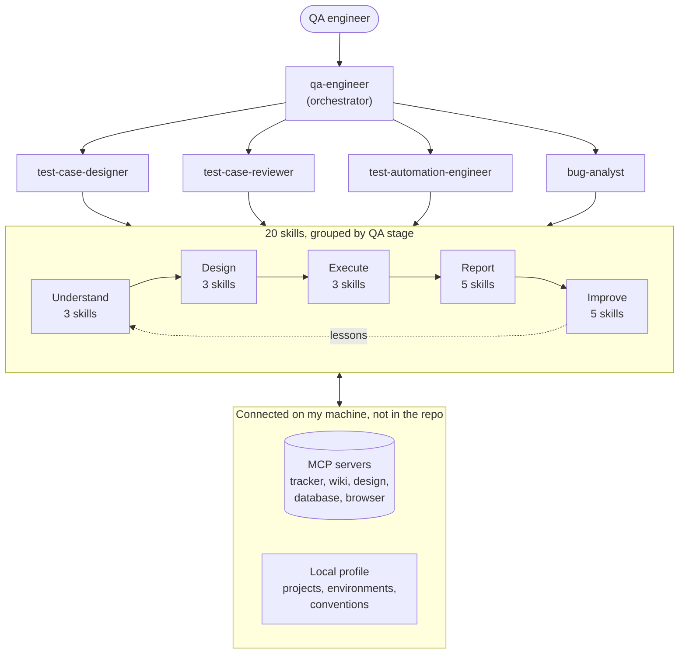
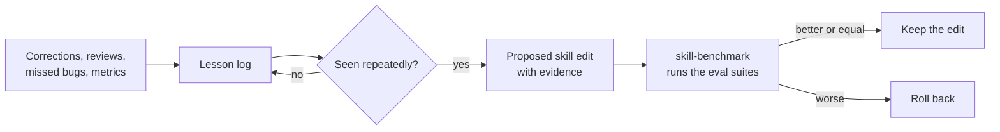

# AI QA Engineer · Claude Code plugin

**An agentic QA engineer for Claude Code: 5 specialist agents, 20 skills and 11 benchmark suites that cover the QA lifecycle from reading requirements to a ship / no-ship verdict.**

> The source code is private. This repository shows the architecture, structure and workflow only.
> Happy to walk through it live: [ksghadia.github.io](https://ksghadia.github.io) · [LinkedIn](https://www.linkedin.com/in/kishan-ghadiya/)

## Why I built it

QA work repeats the same careful steps on every ticket: read every source, find the gaps, design tests that would catch a wrong implementation, run them with evidence, and report honestly. I built this plugin so an AI agent follows that discipline the way a senior QA engineer would, and gets better from my corrections over time.

Design principles:

- **Company-agnostic.** The plugin holds *how* I test. Company tools and context connect locally through MCP servers and a local profile, so the repository carries no employer data and moves with me between jobs.
- **Evidence over claims.** Every verdict cites screenshots, console and network logs, query results or source lines.
- **Human in the loop.** Anything that writes to a tracker, files a bug or creates test cases waits for approval.
- **Measured, not assumed.** Skill changes are benchmarked against eval suites and rolled back if they regress.

## Architecture



One orchestrator hands work to four specialists. Each agent calls the skills for its stage (the full list is in [Skills](#skills)), and the Improve skills feed lessons back into the earlier stages. Company tools and context stay on my machine.

## Workflow

How a ticket moves through the agents, in order:

1. **Understand.** `document-analysis` reads the ticket, specs, designs, API and DB docs and comments, and builds a cited model of the feature. `product-knowledge` supplies what is already known about it.
2. **Question.** `requirement-review` flags vague terms, missing limits and errors, roles, states and contradictions, and drafts questions before any test is written.
3. **Design.** `xray-test-cases` builds condition matrices (boundaries, attack inputs, pairwise, state transitions), checks that each case would catch a wrong implementation, removes duplicates and delivers a review package.
4. **Review.** `test-case-reviewer` re-reads the sources independently and scores the cases against a rubric: atomic, observable, traceable, unique and safe.
5. **Execute.** `run-tests` runs UI cases in the browser with screenshots, console and network evidence. `api-test` covers contracts, status codes, validation and auth. `automate-test` turns stable cases into Playwright tests.
6. **Report.** `bug-report` files reproducible bugs after approval. `test-report` gives an evidence-backed ship / no-ship verdict.
7. **Learn.** Corrections, reviews and missed bugs become lessons. Repeated lessons become skill edits, which are benchmarked before they are kept.

## Agents

| Agent | Role |
|---|---|
| `qa-engineer` | Orchestrator for the full QA lifecycle on a ticket, story or bug fix: "QA this", "verify this fix", "is this ready to ship" |
| `test-case-designer` | Designs unique, traceable test cases from stories, specs, designs and API docs, and delivers a review package |
| `test-case-reviewer` | Independent second opinion: re-reads the sources, scores existing cases, finds gaps and duplicates, suggests rewrites |
| `test-automation-engineer` | Converts manual cases into automated UI and API tests, fixes flaky tests and reviews automation code (Playwright by default) |
| `bug-analyst` | Triages a reported bug: validates it, reproduces it with evidence, finds the root cause, rates impact and drafts developer comments with a verdict |

## Skills

| Stage | Skill | What it does |
|---|---|---|
| Understand | `document-analysis` | Reads every source and builds a cited feature model: actors, flows, rules, data, states |
| | `requirement-review` | Testability review with questions to ask before design |
| | `product-knowledge` | Per-feature knowledge base, looked up before analysis and updated after |
| Design | `test-design` | Partitions, boundaries, decision tables, state transitions and error guessing for quick test ideas |
| | `xray-test-cases` | Import-ready test cases with matrices, a wrong-implementation check and deduplication |
| | `review-test-cases` | Quality rubric plus coverage checks, producing a scored report with rewrites |
| Execute | `run-tests` | Browser execution with screenshots, console and network evidence |
| | `api-test` | REST and GraphQL testing: contract, status codes, validation, auth, data integrity |
| | `automate-test` | Manual cases to automated tests in the project's framework |
| Report | `bug-report` | Reproducible bug reports with a duplicate check, filed after approval |
| | `bug-analysis` | End-to-end bug triage with root cause, impact, fix validation and verdict |
| | `test-report` | Evidence-backed test summary with a ship / no-ship verdict |
| | `regression-scope` | Impact analysis of a PR, branch or release with a risk rating |
| | `standup` | Daily QA standup from tracker, code host and chat activity |
| Improve | `self-improve` | Logs lessons and turns repeated ones into evidence-backed skill edits |
| | `learn-from-edits` | Compares generated test cases with my reviewed version and learns from the differences |
| | `skill-benchmark` | Runs the eval suites to keep or roll back skill changes |
| | `qa-metrics` | Per-release coverage, review scores, detection, leakage and trends |
| | `defect-gap-analysis` | For an escaped bug: why no test caught it, the missing test and a lesson |
| Efficiency | `tool-budget` | Token rules for tracker, design, database, API and browser tool calls |

## Repository structure

Names only. File contents are private.

```
ai-qa-engineer/
├── .claude-plugin/
│   └── marketplace.json              # makes the repo installable as a plugin
├── .githooks/
│   ├── pre-commit                    # blocks credentials and company data
│   └── pre-push                      # same check on every pushed commit
├── docs/
│   └── setup.md
├── profile/
│   └── CLAUDE.example.md             # template for the local, private profile
├── scripts/
│   ├── benchmark.sh                  # runs the eval suites (quick, or full with a no-plugin baseline)
│   ├── check-secrets.py              # secret and company-data scanner used by the hooks
│   └── lint_plugin.py                # consistency lint: catches drift between files that refer to each other
└── plugins/ai-qa-engineer/
    ├── .claude-plugin/plugin.json
    ├── agents/                       # 5 agents
    │   ├── qa-engineer.md
    │   ├── test-case-designer.md
    │   ├── test-case-reviewer.md
    │   ├── test-automation-engineer.md
    │   └── bug-analyst.md
    ├── skills/                       # 20 skills, one folder each with a SKILL.md
    │   ├── document-analysis/
    │   ├── requirement-review/
    │   ├── product-knowledge/
    │   ├── test-design/
    │   ├── xray-test-cases/
    │   │   └── references/           # coverage, grounding, writing, export and structure guides
    │   ├── review-test-cases/
    │   ├── run-tests/
    │   ├── api-test/
    │   ├── automate-test/
    │   ├── bug-report/
    │   ├── bug-analysis/
    │   ├── test-report/
    │   ├── regression-scope/
    │   ├── standup/
    │   ├── self-improve/
    │   ├── learn-from-edits/
    │   ├── skill-benchmark/
    │   ├── qa-metrics/
    │   ├── defect-gap-analysis/
    │   └── tool-budget/
    ├── hooks/                        # learning-loop hooks
    ├── scripts/
    │   ├── render_test_cases.py      # test cases → Markdown, Excel and Xray CSV
    │   ├── generate_conditions.py    # boundaries, attack inputs, pairwise, state transitions
    │   └── extract_rule_sentences.py # every rule-like sentence in the sources, for completeness
    ├── evals/                        # 11 synthetic benchmark suites with graders
    └── evals-local/                  # real-ticket cases, kept out of git
```

## Benchmarks

Each suite has a prompt and graders. Several contain deliberately planted bugs or gaps that a good run must find. A full run repeats every case three times; the benchmark script can also add a no-plugin baseline run for comparison.

| Suite | What it checks |
|---|---|
| `requirement-review-upload` | Finds testability gaps in a story |
| `document-analysis-hidden-decisions` | Surfaces decisions buried in the source documents |
| `design-password-reset` | Designs complete, non-duplicated cases for a familiar flow |
| `review-weak-cases` | Spots and rewrites weak test cases |
| `gap-analysis-ui-only` | Notices when only the UI is covered |
| `run-tests-evidence` | Executes with proper evidence |
| `api-test-contract` | Catches contract and validation problems |
| `bug-report-quality` | Writes a reproducible, complete bug report |
| `bug-analysis-triage` | Reaches the right verdict and root cause |
| `regression-scope-release` | Scopes regression for a release with risk |
| `test-report-verdict` | Gives an honest ship / no-ship verdict |

### Latest results

Plugin v0.2.3, 3 runs per suite, latest full run of each suite (14–15 Oct 2026). A run passes when its graders accept it; the score is the average grader score across the three runs (1.00 means every run fully passed).

| Suite | Runs passed | Score |
|---|---|---|
| `requirement-review-upload` | 3 / 3 | 1.00 |
| `document-analysis-hidden-decisions` | 3 / 3 | 1.00 |
| `gap-analysis-ui-only` | 3 / 3 | 1.00 |
| `review-weak-cases` | 3 / 3 | 1.00 |
| `run-tests-evidence` | 3 / 3 | 1.00 |
| `regression-scope-release` | 3 / 3 | 1.00 |
| `bug-analysis-triage` | 3 / 3 | 1.00 |
| `test-report-verdict` | 3 / 3 | 1.00 |
| `api-test-contract` | 2 / 3 | 0.89 |
| `bug-report-quality` | 2 / 3 | 0.89 |
| `design-password-reset` | 2 / 3 | 0.67 |
| **All 11 suites** | **30 / 33 (91%)** | **0.95** |

The three suites below 3 / 3 are the current focus of the learning loop. These are with-plugin results only; a no-plugin baseline comparison has not been recorded yet.

## Learning loop



## Safety

- **No secrets or employer data in the repo.** Git hooks scan every commit and push for credential values, credential shapes and a local deny-list of company names, domains and ticket prefixes. The deny-list itself lives outside the repo.
- **Credentials stay in environment variables** on the local machine, referenced by name only.
- **Read-only by default** for production data. Writes to trackers or test management happen only after explicit approval.

## Tech

Claude Code plugin format · Model Context Protocol (MCP) · Python scripts · Playwright · Jira and Xray · Markdown and JSON skill definitions

---

Built and maintained by **Kishan Ghadiya**, Senior SDET. The code is private, but I'm glad to demo it in an interview.
